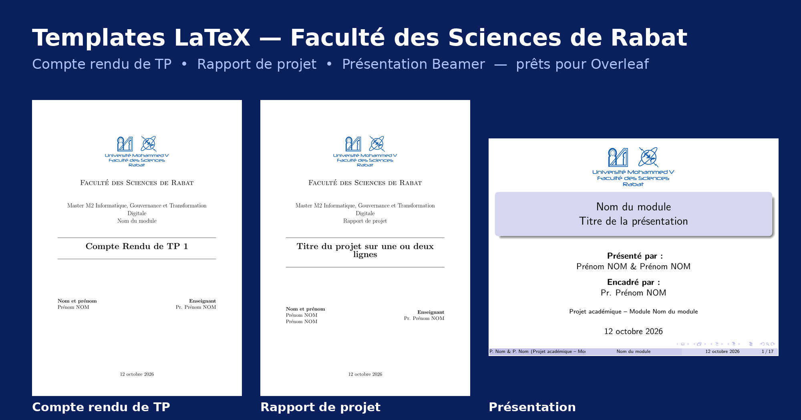
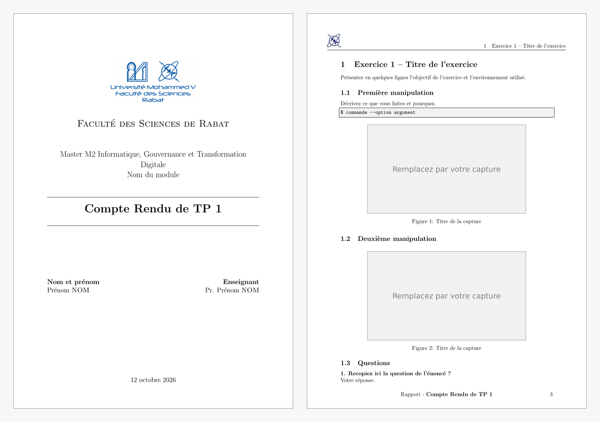
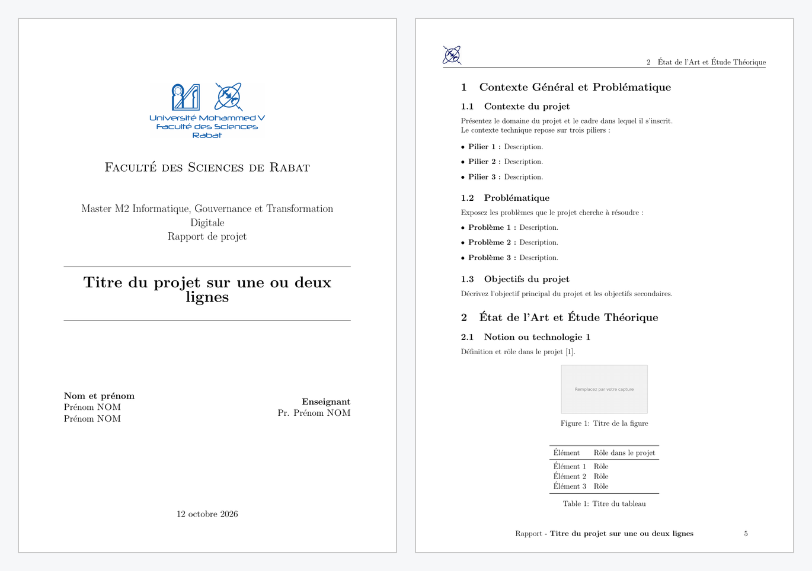
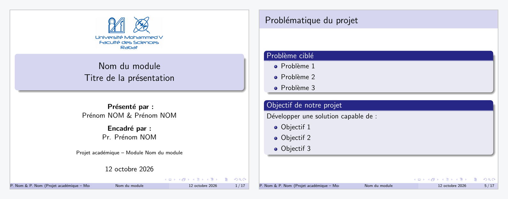

# Templates LaTeX — Faculté des Sciences de Rabat

Trois templates LaTeX prêts à l'emploi pour les étudiants du **Master IGOV** et des autres masters de la **Faculté des Sciences de Rabat (Université Mohammed V)** : compte rendu de TP, rapport de projet et présentation de soutenance.

Ils viennent des rapports que j'ai rendus pendant mon Master IGOV. Je les ai vidés de leur contenu pour que chacun puisse se concentrer sur le fond, sans perdre de temps sur la mise en page.



## Les templates

| Template | Contenu | Ouvrir dans Overleaf | Aperçu PDF |
|---|---|---|---|
| **Compte rendu de TP** | Page de garde FSR, table des matières, exercices, manipulations, captures, questions/réponses | [](https://www.overleaf.com/docs?snip_uri=https://raw.githubusercontent.com/TON-PSEUDO/templates-latex-fsr/main/zips/rapport-tp.zip) | [rapport-tp.pdf](apercus/rapport-tp.pdf) |
| **Rapport de projet** | Page de garde FSR, glossaire, contexte et problématique, état de l'art, conception, réalisation, bilan, bibliographie | [](https://www.overleaf.com/docs?snip_uri=https://raw.githubusercontent.com/TON-PSEUDO/templates-latex-fsr/main/zips/rapport-projet.zip) | [rapport-projet.pdf](apercus/rapport-projet.pdf) |
| **Présentation (Beamer)** | Page de titre avec logo FSR, plan, diapositives de transition, blocs, figures, code, conclusion | [](https://www.overleaf.com/docs?snip_uri=https://raw.githubusercontent.com/TON-PSEUDO/templates-latex-fsr/main/zips/presentation.zip) | [presentation.pdf](apercus/presentation.pdf) |

### Compte rendu de TP


### Rapport de projet


### Présentation


## Utilisation en 3 étapes

1. **Ouvrir le template** : cliquez sur le bouton « Ouvrir dans Overleaf » du template voulu.
   Autre méthode : téléchargez le `.zip` dans le dossier [`zips/`](zips), puis dans Overleaf : **New Project › Upload Project**.
2. **Remplir vos informations** en haut de `main.tex` :
   ```latex
   \titre{Compte Rendu de TP 1}
   \sujet{Nom du module}
   \enseignant{Pr. Prénom \textsc{NOM}}
   \eleves{Prénom \textsc{NOM}}
   ```
   Pour plusieurs étudiants : `\eleves{Prénom \textsc{NOM} \\ Prénom \textsc{NOM}}`.
3. **Remplacer les images** : déposez vos captures dans le projet et gardez le nom de fichier, ou changez-le dans `\includegraphics{...}`. Puis **Recompile**.

## Vous n'êtes pas en Master IGOV ?

L'intitulé du master est écrit dans `rapportFSR.cls` (ligne de la page de garde) :

```latex
{\Large Master M2 Informatique, Gouvernance et Transformation Digitale\par}
```

Remplacez-le par le nom de votre master. C'est la seule modification nécessaire.

## Structure du dépôt

```
templates-latex-fsr/
├── rapport-tp/          # compte rendu de TP (main.tex + rapportFSR.cls + logos/)
├── rapport-projet/      # rapport de projet (main.tex + rapportFSR.cls + logos/)
├── presentation/        # présentation Beamer (main.tex + logos/)
├── zips/                # les trois templates prêts à importer dans Overleaf
└── apercus/             # aperçus PNG et PDF
```

## Bon à savoir

- **Compilateur** : pdfLaTeX (par défaut sur Overleaf).
- **Langue** : français (`babel`), la date s'affiche automatiquement en français.
- **Code** : le style `console` sert aux commandes de terminal ; `listings` gère les accents dans le code.
- **Logos** : les logos de l'Université Mohammed V et de la Faculté des Sciences de Rabat appartiennent à leurs institutions. Ils sont fournis uniquement pour les travaux académiques des étudiants de la FSR.

## Contribuer

Une amélioration, un template pour un autre type de document (PFE, mémoire, poster) ? Ouvrez une *issue* ou une *pull request*.

## Auteur

**Adnane El Harti** — Master IGOV, Faculté des Sciences de Rabat
[LinkedIn](https://www.linkedin.com/in/adnanelharti/)

Si ces templates vous font gagner du temps, laissez une ⭐ au dépôt et partagez-le avec votre promo.

## Licence

Code LaTeX sous licence [MIT](LICENSE). Les logos sont exclus de cette licence (voir « Bon à savoir »).
